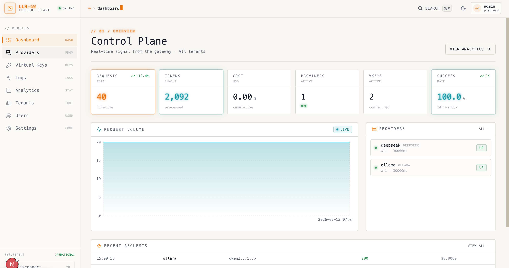
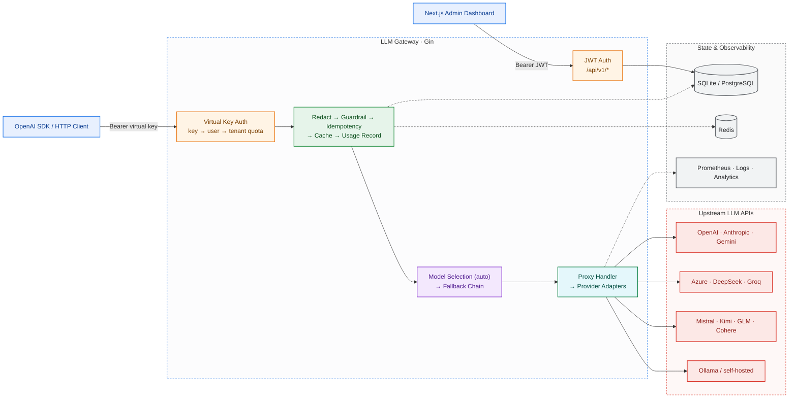

# LLM Gateway

<p align="center">
  <strong>English</strong> ·
  <a href="README.zh-CN.md">中文</a> ·
  <a href="docs/api.md">API Reference</a> ·
  <a href="LICENSE">License</a>
</p>

LLM Gateway is a unified LLM API gateway built with Go. It exposes one OpenAI-compatible API for multiple model providers, with virtual keys, usage tracking, caching, routing, and an admin dashboard.

## What You Can Do

- Call multiple providers through OpenAI-compatible endpoints such as `/v1/chat/completions`
- Issue virtual keys to applications and track usage, budgets, and request logs by key
- Route traffic across providers and models with fallback chains and auto model selection
- Enable in-memory or Redis caching to reduce repeated request cost
- Manage providers, virtual keys, tenants, users, alerts, and analytics from the Next.js dashboard



## Quick Start

### 1. Install dependencies

```bash
make deps
```

### 2. Build and start

```bash
make build
make start
```

- Backend API: `http://localhost:18080`
- Admin dashboard: `http://localhost:3000`
- Logs: `/tmp/llm-gateway-backend.log` and `/tmp/llm-gateway-frontend.log`

To stop the services:

```bash
make stop
```

> Docker (`docker compose up`) exposes the gateway on `http://localhost:8080` with Postgres and Redis.

### 3. Log in and add a provider

Open the dashboard and sign in with the default admin account (`admin@llmgw.org / admin123`, change it in production).

On the Providers page, add a provider with its `apiKey` and `customHost` — for local Ollama, use `http://localhost:11434/v1`. On the same page, fill in the model prices so usage tracking can compute costs.

Alternatively, generate seed data (tenants, users, virtual keys, demo traffic) with:

```bash
make seed
```

### 4. Create a virtual key and call the API

Create a virtual key in the dashboard, then use it with the OpenAI-compatible API:

```bash
curl -X POST http://localhost:18080/v1/chat/completions \
  -H "Content-Type: application/json" \
  -H "Authorization: Bearer your-virtual-key" \
  -d '{
    "model": "qwen2.5:7b",
    "messages": [{"role": "user", "content": "Hello!"}]
  }'
```

Set `"model": "auto"` (or omit it) to let the gateway pick a provider/model by cost, concurrency, and recent usage.

## Architecture



### Request flow

```text
Client
  -> /v1/*
  -> Virtual Key Auth (+ key/user/tenant quota cascade)
  -> Redact / Guardrail / Idempotency / Usage Record / Cache
  -> Model Selection (auto mode) or Provider Entry
  -> Fallback Chain (per-provider retry settings)
  -> Proxy Handler
  -> Provider Adapter
  -> Upstream LLM API
```

Requests with `model: "auto"` are scored across enabled provider/model pairs (cost, inflight concurrency, recent usage, error rate) and the winner is returned in `x-llm-selected-*` response headers. Provider entries can name `fallbacks`: when the primary fails with a retryable status, each fallback is tried in order.

## API Reference

- [API Reference](docs/api.md)
- OpenAI-compatible endpoints: `/v1/chat/completions`, `/v1/completions`, `/v1/embeddings`, `/v1/models`, `/v1/images/generations`, `/v1/audio/*`, `/v1/messages` (Anthropic-compatible), and a generic `/v1/proxy/*path`
- Virtual keys authenticate via the standard OpenAI-style `Authorization: Bearer <virtual-key>` header
- Admin APIs use `Authorization: Bearer <token>` JWT authentication

## Core Capabilities

| Capability             | Description                                                                                                          |
| ---------------------- | -------------------------------------------------------------------------------------------------------------------- |
| Multi-provider support | Built-in adapters for OpenAI, Anthropic, Gemini, Azure, DeepSeek, Groq, Mistral, Kimi, GLM, Cohere, Ollama, and more |
| Unified API            | Exposes OpenAI-compatible endpoints, including streaming (SSE) and Anthropic-style `/v1/messages`                  |
| Virtual keys           | Protect real provider keys, restrict allowed providers/models, and track usage and budgets per key                   |
| Quota cascade          | Monthly quotas enforced down the key → user → tenant chain with async budget tracking                              |
| Routing                | Fallback chains with per-provider retry, plus auto model selection scored on cost, concurrency, and error rate       |
| Caching                | Supports in-memory and Redis cache backends, plus idempotency-key response replay                                    |
| Privacy masking        | Stable-placeholder masking of secrets and custom words in requests and responses, configurable from Settings         |
| Multi-tenancy          | Supports tenants, users, roles (super_admin / tenant_admin / member), and tenant-scoped data isolation               |
| Observability          | Provides request logs, usage records, analytics, provider health checks, and Prometheus metrics                      |

## Common Commands

| Command               | Description                                                                         |
| --------------------- | ----------------------------------------------------------------------------------- |
| `make deps`         | Install backend and frontend dependencies                                           |
| `make dev`          | Start backend and frontend in the foreground                                        |
| `make start`        | Start backend and frontend in the background                                        |
| `make restart`      | Stop and start the local services                                                   |
| `make stop`         | Stop local services                                                                 |
| `make build`        | Build the backend binary and frontend assets                                        |
| `make test`         | Run Go unit tests                                                                   |
| `make lint`         | Lint Go code (`golangci-lint`)                                                    |
| `make fmt`          | Format Go code                                                                      |
| `make seed`         | Seed data (tenants, users, ollama provider, virtual keys) and generate demo traffic |
| `make traffic-demo` | Generate demo traffic                                                               |
| `make load-test`    | Run load-test scenarios (also `-json`, `-stream`, `-soak`, capacity targets)  |

## Project Structure

```text
llm-gateway/
├── cmd/
│   ├── server/              # Server entrypoint and route registration
│   └── generate-traffic/    # Demo traffic and load-test scenarios
├── internal/
│   ├── config/              # Viper configuration loading (env overrides via LLM_GATEWAY_*)
│   ├── database/            # GORM database layer (SQLite/PostgreSQL)
│   ├── handler/             # HTTP handlers (auth, stats, usage, virtual keys, tenants, users, ...)
│   ├── logstore/            # Usage-record storage
│   ├── metrics/             # Prometheus metrics
│   ├── middleware/          # Gin middleware (auth, quota, redact, guardrail, cache, idempotency, ...)
│   ├── models/              # GORM data models
│   ├── provider/            # LLM provider adapters
│   ├── seed/                # Seed manifest types
│   ├── service/             # Business services (model selector, quotas, alerts, ...)
│   └── types/               # Shared type definitions
├── pkg/
│   ├── cache/               # Memory / Redis cache
│   ├── encryption/          # AES-256-GCM encryption for keys at rest
│   ├── guardrail/           # Request / response guardrails
│   ├── proxy/               # Core proxy logic (fallback chain, auto model selection)
│   ├── redact/              # Privacy masking engine
│   └── retry/               # Retry logic with backoff
├── web/frontend/            # Next.js admin dashboard
│   └── app/                 # Pages: dashboard, analytics, logs, virtual-keys, providers, tenants, users, settings
├── configs/config.yaml      # Default configuration (infrastructure settings only)
├── docs/                    # API reference and benchmarking runbook
└── Makefile                 # Local development commands
```

Providers are not listed in `config.yaml` — they live in the database and are edited from the admin console. Only infrastructure settings (server, database, cache, budget, logging, security) belong in the config file.

## Open Source

Issues and pull requests are welcome. Before submitting changes, run:

```bash
make test
make fmt
```

## Security

- Do not commit real API keys, JWT secrets, or production configuration
- Change the default admin password and `security.jwtSecret` in production
- If you find a security issue, contact the maintainers privately before publicly disclosing exploitable details

## License

MIT License. See [LICENSE](LICENSE).
