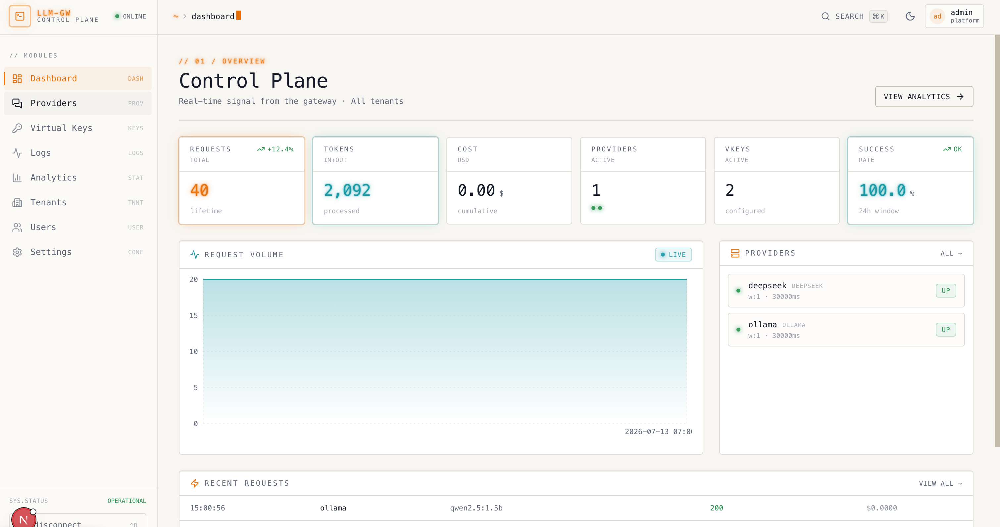

# LLM Gateway

<p align="center">
  <a href="README.md">English</a> ·
  <strong>中文</strong> ·
  <a href="docs/api.md">API Reference</a> ·
  <a href="LICENSE">License</a>
</p>

LLM Gateway 是一个用 Go 构建的统一 LLM API 网关：用一套 OpenAI-compatible API 接入多个模型服务，并提供虚拟密钥、用量统计、缓存、路由和管理后台。

## 你可以用它做什么

- 用 `/v1/chat/completions` 等 OpenAI-compatible 接口统一调用不同 provider
- 给业务方发放虚拟密钥，并按 key 统计用量、预算和请求记录
- 在多个 provider / model 之间做故障转移和 auto 模型自动选择
- 开启内存或 Redis 缓存，降低重复请求成本
- 通过 Next.js 管理后台维护 provider、虚拟密钥、租户、用户、告警和统计报表



## 快速开始

### 1. 安装依赖

```bash
make deps
```

### 2. 构建并启动

```bash
make build
make start
```

- 后端 API：`http://localhost:18080`
- 前端控制台：`http://localhost:3000`
- 日志：`/tmp/llm-gateway-backend.log` 和 `/tmp/llm-gateway-frontend.log`

停止服务：

```bash
make stop
```

> Docker 部署（`docker compose up`）时网关暴露在 `http://localhost:8080`，并附带 Postgres 与 Redis。

### 3. 登录并添加 provider

打开控制台，使用默认管理员账号登录（`admin@llmgw.org / admin123`，生产环境请修改）。

在 Providers 页面添加 provider，按需填写 `apiKey` 和 `customHost`——本地 Ollama 填 `http://localhost:11434/v1`。同时在页面中补充 model 价格，用量统计才能计算成本。

也可以一键生成 seed 数据（租户、用户、虚拟密钥、演示流量）：

```bash
make seed
```

### 4. 创建虚拟密钥并调用

登录控制台创建 Virtual Key 后，用它调用 OpenAI-compatible API：

```bash
curl -X POST http://localhost:18080/v1/chat/completions \
  -H "Content-Type: application/json" \
  -H "x-llm-gateway-api-key: your-virtual-key" \
  -d '{
    "model": "qwen2.5:7b",
    "messages": [{"role": "user", "content": "Hello!"}]
  }'
```

把 `model` 设为 `"auto"`（或省略）可让网关按成本、并发与近期用量自动选择 provider/model。

## 架构设计图


### 请求链路

```text
Client
  -> /v1/*
  -> Virtual Key Auth（含 key → 用户 → 租户配额级联）
  -> Redact / Guardrail / Idempotency / Usage Record / Cache
  -> 模型选择（auto 模式）或 Provider 配置
  -> Fallback 链（每个 provider 独立重试配置）
  -> Proxy Handler
  -> Provider Adapter
  -> Upstream LLM API
```

`model: "auto"` 的请求会在所有启用的 provider/model 组合上打分（成本、在途并发、近期用量、错误率），胜出者通过 `x-llm-selected-*` 响应头返回。Provider 条目可以配置 `fallbacks`：主 provider 返回可重试错误时按顺序尝试备选。

## API 文档

- [API Reference](docs/api.md)（英文）
- OpenAI-compatible 接口：`/v1/chat/completions`、`/v1/completions`、`/v1/embeddings`、`/v1/models`、`/v1/images/generations`、`/v1/audio/*`、`/v1/messages`（Anthropic-compatible），以及通用代理 `/v1/proxy/*path`
- OpenAI-compatible API 使用 `x-llm-gateway-api-key` 虚拟密钥认证（也支持 `Authorization: Bearer <virtual-key>` 和 `x-api-key`）
- Admin API 使用 `Authorization: Bearer <token>` JWT 认证

## 核心能力

| 能力        | 说明                                                                                               |
| ----------- | -------------------------------------------------------------------------------------------------- |
| 多 Provider | 内置 OpenAI、Anthropic、Gemini、Azure、DeepSeek、Groq、Mistral、Kimi、GLM、Cohere、Ollama 等适配器 |
| 统一协议    | 对外提供 OpenAI-compatible API，含 SSE 流式与 Anthropic 风格的 `/v1/messages`                    |
| 虚拟密钥    | 使用网关密钥隔离真实 provider key，可限制可用 provider/model，按 key 统计用量与预算                |
| 配额级联    | 月度配额沿 key → 用户 → 租户逐级校验，预算异步记账                                               |
| 路由        | Fallback 链 + 每个 provider 独立重试配置；auto 模式按成本/并发/错误率自动选型                      |
| 缓存        | 支持内存缓存和 Redis 缓存，并支持 Idempotency-Key 响应重放                                         |
| 隐私脱敏    | 请求/响应中的敏感值用稳定占位符掩码，可在 Settings 中配置                                          |
| 多租户      | 支持租户、用户、角色（super_admin / tenant_admin / member）和租户级数据隔离                        |
| 可观测性    | 提供请求日志、用量记录、统计分析、provider 健康检查和 Prometheus metrics                           |

## 常用命令

| 命令                  | 说明                                                                      |
| --------------------- | ------------------------------------------------------------------------- |
| `make deps`         | 安装后端和前端依赖                                                        |
| `make dev`          | 前台启动后端和前端                                                        |
| `make start`        | 后台启动后端和前端                                                        |
| `make restart`      | 停止并重新启动本地服务                                                    |
| `make stop`         | 停止本地服务                                                              |
| `make build`        | 构建后端二进制和前端产物                                                  |
| `make test`         | 运行 Go 单元测试                                                          |
| `make lint`         | 运行 Go 代码检查（`golangci-lint`）                                     |
| `make fmt`          | 格式化 Go 代码                                                            |
| `make seed`         | 生成 seed 数据（租户、用户、ollama provider、虚拟密钥）并调用网关生成流量 |
| `make traffic-demo` | 生成演示流量                                                              |
| `make load-test`    | 运行压测场景（另有 `-json`、`-stream`、`-soak` 与容量目标命令）     |

## 项目结构

```text
llm-gateway/
├── cmd/
│   ├── server/              # 服务入口与路由注册
│   └── generate-traffic/    # 演示流量与压测场景
├── internal/
│   ├── config/              # Viper 配置加载（环境变量前缀 LLM_GATEWAY_*）
│   ├── database/            # GORM 数据库层（SQLite/PostgreSQL）
│   ├── handler/             # HTTP handlers（auth、stats、usage、virtual keys、tenants、users 等）
│   ├── logstore/            # 用量记录存储
│   ├── metrics/             # Prometheus 指标
│   ├── middleware/          # Gin middleware（认证、配额、脱敏、护栏、缓存、幂等等）
│   ├── models/              # 数据模型
│   ├── provider/            # LLM provider adapters
│   ├── seed/                # seed manifest 类型
│   ├── service/             # 业务服务（模型选择、配额、告警等）
│   └── types/               # 共享类型定义
├── pkg/
│   ├── cache/               # Memory / Redis cache
│   ├── encryption/          # 静态密钥 AES-256-GCM 加密
│   ├── guardrail/           # 请求 / 响应护栏
│   ├── proxy/               # 核心代理逻辑（fallback 链、auto 模型选择）
│   ├── redact/              # 隐私脱敏引擎
│   └── retry/               # 重试机制
├── web/frontend/            # Next.js 管理后台
│   └── app/                 # 页面：dashboard、analytics、logs、virtual-keys、providers、tenants、users、settings
├── configs/config.yaml      # 默认配置（仅基础设施配置）
├── docs/                    # API 参考与压测手册
└── Makefile                 # 本地开发命令
```

Provider 不在 `config.yaml` 中配置——它们存放在数据库里，通过管理后台维护。配置文件只保留基础设施设置（server、database、cache、budget、logging、security）。

## 开源协作

欢迎提交 Issue 和 Pull Request。建议在提交前运行：

```bash
make test
make fmt
```

## 安全

- 不要提交真实 API Key、JWT Secret 或生产配置
- 生产环境请修改默认管理员密码和 `security.jwtSecret`
- 如果发现安全问题，请优先通过私有渠道联系维护者，避免公开披露可利用细节

## 许可证

MIT License. See [LICENSE](LICENSE).
